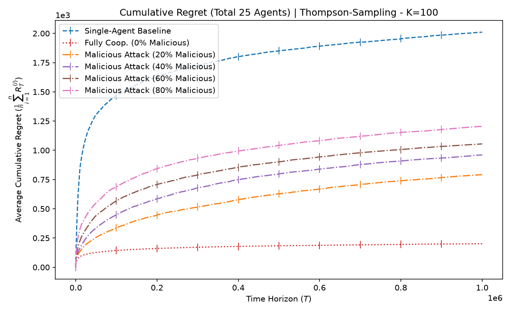
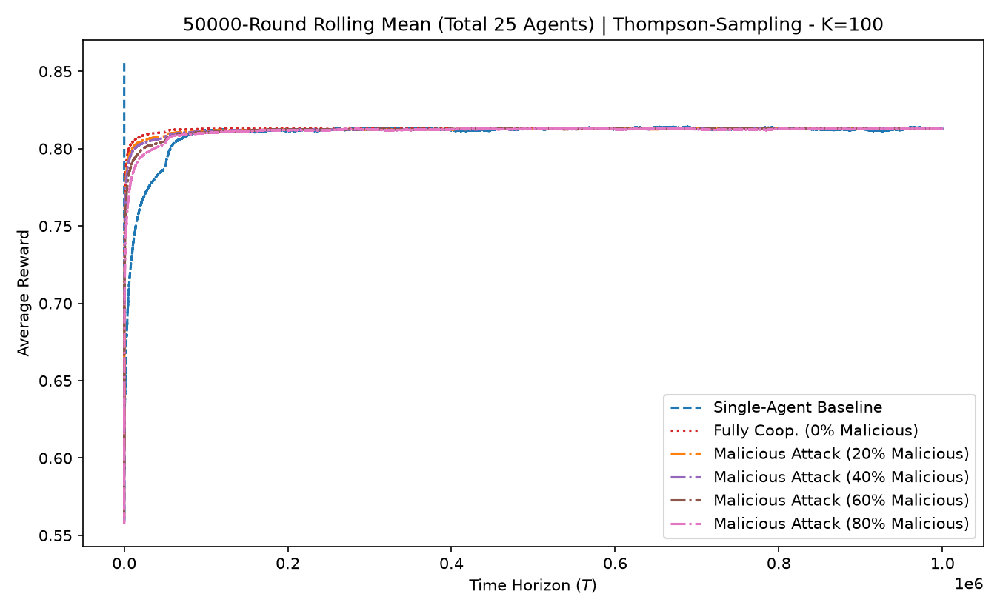

# Single-Agent vs Multi-Agent Multi-Armed Bandits Simulation

This project simulates and evaluates the vulnerabilities and active peer-defense mechanisms of collaborative Multi-Armed Bandit (MAB) algorithms using real-world data from the MovieLens 20M dataset. 

It compares a Single-Agent baseline against a Cooperative Multi-Agent network (`GosInE`). To rigorously test the network's robustness against data poisoning, the total network size is kept strictly constant ($N_{total} = 25$), while the ratio of Honest to Malicious agents is dynamically shifted (from 0% up to 80% malicious).

The framework supports:
* **3 Bandit Exploration Policies**: `UCB`, `Epsilon-Greedy`, and `Thompson-Sampling`
* **4 Gossip Defense Modes**:
  * `none` — Unprotected `GosInE` baseline (blind peer selection & replacement)
  * `gosine_block` — Escalating Peer Blocking (`GosInE-Block`, Vial et al., 2021)
  * `pure_brs` — Standalone Soft Beta Reputation (`Pure BRS-GosInE`, Jøsang & Ismail, 2002 adapted)
  * `hybrid_brs_block` — Reputation-Scaled Escalating Blocking (`Hybrid BRS-Block`)
* **Concurrent Multiprocessing**: Runs all 6 network scenarios (Single-Agent + 0%, 20%, 40%, 60%, and 80% malicious) in parallel.

---

## ⚙️ How to Run

### 1. Running the Main Simulation (`main.py` & `run.bat`)
To run the simulation, execute `main.py` directly or use `run.bat` to run all 12 combinations (4 defense algorithms $\times$ 3 bandit policies).

By default, the simulation maintains a strict total of **25 agents** and tests malicious scenarios at 0%, 20%, 40%, 60%, and 80% network toxicity.

| Argument | Short | Description | Default |
| :--- | :---: | :--- | :--- |
| `--data` | | Path to the MovieLens `ratings.csv` file | `data/ml-20m/ratings.csv` |
| `--k_arms` | `-k` | Number of movies (arms) to process | `1000` |
| `--t_horizon` | `-t` | Total time steps (Auto-calculates to $K \times 250$ if omitted) | *Auto* |
| `--policy` | | Bandit policy to use (`UCB`, `Epsilon-Greedy`, `Thompson-Sampling`) | `UCB` |
| `--explore_param` | | Exploration parameter (`1.5` for UCB, `20000.0` for Epsilon-Greedy, `1.0` for TS if omitted) | *Auto* |
| `--beta` | | Phase duration scaling parameter ($A_j = \lceil j^\beta \rceil$) | `2.0` |
| `--defense` | | Active gossip defense mode (`none`, `gosine_block`, `pure_brs`, `hybrid_brs_block`) | `none` |
| `--eta` | | Base polynomial blocking exponent ($\eta > 1$) for `gosine_block` and `hybrid_brs_block` | `2.0` |
| `--lam` | | Beta Reputation forgetting factor ($\lambda \in (0, 1]$) for `pure_brs` and `hybrid_brs_block` | `0.85` |
| `--theta_min` | | Minimum reputation cutoff ($\theta_{\min} \in (-1, 0)$) for `pure_brs` peer quarantine | `-0.50` |
| `--subfolder` | | Optional subfolder inside `results/` to store outputs (e.g., `Run1`) | `""` |
| `--no_show` | | Saves the plots in the background without opening a window | *False* |

**Examples:**
*   **Run Unprotected Baseline (`none`) with UCB:**
    ```bash
    python main.py -k 100 -t 1000000 --policy UCB --defense none --no_show
    ```
*   **Run `GosInE-Block` (`gosine_block`) with UCB:**
    ```bash
    python main.py -k 100 -t 1000000 --policy UCB --defense gosine_block --eta 2.0 --no_show
    ```
*   **Run `Pure BRS-GosInE` (`pure_brs`) with Epsilon-Greedy:**
    ```bash
    python main.py -k 100 -t 1000000 --policy Epsilon-Greedy --defense pure_brs --lam 0.85 --theta_min -0.50 --no_show
    ```
*   **Run `Hybrid BRS-Block` (`hybrid_brs_block`) with Thompson Sampling into `results/Run1/`:**
    ```bash
    python main.py -k 100 -t 1000000 --policy Thompson-Sampling --defense hybrid_brs_block --eta 2.0 --lam 0.85 --subfolder Run1 --no_show
    ```
*   **Run the full 12-experiment batch suite (`run.bat`):**
    ```powershell
    .\run.bat
    # Or save all 12 runs into a specific subfolder (e.g., results\Run7\):
    .\run.bat Run7
    ```

*(Note: Data and plots are automatically saved to `results/` or `results/<subfolder>/` with filenames like `mab_results_ConstantTotal_UCB_K100_T1000000.npz` for `none` and `mab_results_ConstantTotal_UCB_<defense>_K100_T1000000.npz` for active defenses).*

---

### 2. Redrawing Graphs (`utils/replot.py`)
If you want to redraw your graphs, isolate specific lines, or magnify the convergence gaps using the zoom feature:

| Argument | Description |
| :--- | :--- |
| `--file` | The specific `.npz` file to load from the `results/` folder (supports relative paths like `Run1/mab_results_...npz`) |
| `--single` | Flag to plot the Single-Agent Baseline |
| `--coop` | Flag to plot the Fully Cooperative Multi-Agent (0% Malicious) |
| `--malicious` | Flag to plot the Malicious Scenarios (20%, 40%, 60%, 80%) |
| `--zoom` | Intuitively zoom in on the end of the timeline (e.g., `80` fast-forwards past the first 80% of the graph and auto-scales the Y-axis to magnify the final 20%) |
| `--no_show`| Save the newly generated plots without popping up the window |

**Example:**
*   **Magnify the Malicious Damage (Exclude Single-Agent & Zoom in 80%):**
    ```bash
    python utils/replot.py --file mab_results_ConstantTotal_UCB_gosine_block_K100_T1000000.npz --coop --malicious --zoom 80 --no_show
    ```

---

### 3. Comparing Policies Head-to-Head (`utils/compare_policies.py`)
To test which bandit policy (`UCB`, `Epsilon-Greedy`, or `Thompson-Sampling`) is the most robust under a given defense and scenario, plot them against each other.

*(Note: You must first run `main.py` for all three policies using the exact same parameters and defense mode so the script has the matching `.npz` files to compare!)*

| Argument | Description |
| :--- | :--- |
| `--suffix` | The shared end of the `.npz` filenames after `<POLICY>_` (e.g., `K100_T1000000` for `none`, or `gosine_block_K100_T1000000` for `gosine_block`) |
| `--target` | The specific scenario to compare: `single`, `coop`, or the exact $m$ value (`5`, `10`, `15`, or `20` for 80% Malicious) |
| `--zoom` | Zoom in on the end of the timeline (e.g., `80` auto-scales to the final 20%) |
| `--no_show`| Save the newly generated plots without popping up the window |

**Examples:**
*   **Compare the 3 policies in a Perfect Cooperative Network:**
    ```bash
    python utils/compare_policies.py --suffix K100_T1000000 --target coop --no_show
    ```
*   **Compare the 3 policies under an 80% Attack ($m=20$) with `hybrid_brs_block`:**
    ```bash
    python utils/compare_policies.py --suffix hybrid_brs_block_K100_T1000000 --target 20 --zoom 80 --no_show
    ```

---

### 4. Comparing Single-Agent vs. Cooperative Across All 3 Policies (`utils/compare_single_vs_coop.py`)
Generates a 6-line plot comparing the Single-Agent Baseline against the 25-Agent Cooperative system (0% Malicious) across all three bandit policies simultaneously:

```bash
python utils/compare_single_vs_coop.py --suffix K100_T1000000 --zoom 80 --no_show
```

---

### 5. Exporting to Excel / CSV (`utils/export_csv.py`)
To convert the `.npz` binary archive into a labeled `.csv` file (for viewing in Excel or statistical software):

```bash
python utils/export_csv.py --file mab_results_ConstantTotal_UCB_K100_T1000000.npz
```
This generates a matching `.csv` file right next to the `.npz` archive in the `results/` folder.

### Example Results


